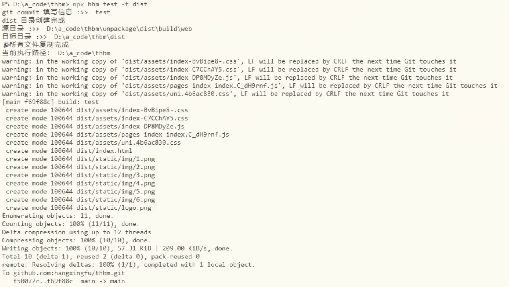

# hbuilder-build-move

HBuilderX 打包 H5 之后，一条命令把产物从 `unpackage/dist/build/web` 同步到项目里指定的目录，并顺手 `git add / commit / push`。

省掉每次发版都要做的三件事：手动复制、手动粘贴、手动提交。

## 安装

```shell
npm i -g hbuilder-build-move
```

命令名是 `hbm`，装完直接可用（不想全局装也可以用 `npx hbm`）。

环境要求：

- Node.js 18 及以上
- 项目已初始化 git，且命令行能正常 `git push`（SSH key 或凭据已配好）

## 用法

在 **HBuilderX 项目根目录** 下执行：

```shell
# 打包完成后，提交并推送，commit 信息为「更新首页样式」
hbm 更新首页样式

# 目标目录默认是 build/h5，可以改成别的
hbm 更新首页样式 -t dist

# 目标目录可以是多级路径，不存在会自动创建
hbm 更新首页样式 -t static/h5
```

| 参数 | 说明 | 默认值 |
| --- | --- | --- |
| `[string]` | git commit 信息，最终会拼成 `build: <你的信息>` | `test` |
| `-t, --target <path>` | 产物输出目录，相对项目根目录 | `build/h5` |
| `-V, --version` | 查看版本 | - |
| `-h, --help` | 查看帮助 | - |

## 执行流程

1. 从当前工作目录向上查找，第一个含 `package.json` 或 `.git` 的目录认作项目根目录
2. 检查项目根目录下有没有 `.git`，没有就报错退出
3. 检查 `unpackage/dist/build/web/index.html` 是否存在，不存在说明还没打包，报错退出
4. 目标目录：不存在则创建；已存在则整个删掉重建
5. 递归把产物拷到目标目录（源产物保留）
6. 依次执行 `git add .`、`git commit -m "build: <信息>"`、`git push`，任何一步失败立即中断

跑起来的样子：



## 注意事项

- **在项目根目录或其子目录里运行。** 它会从当前目录往上找第一个含 `package.json` 或 `.git` 的目录当项目根，在项目外执行会认错根目录。
- **目标目录会被整体删除。** `-t` 不要指向源码目录，比如 `-t src` 会把 `src` 删掉再复制作物进去。
- **`git add .` 是全量提交。** 跑之前确认工作区没有别的半成品改动，否则会被一并提交。建议在 `.gitignore` 里忽略 `unpackage/`，否则打包产物源目录也会进版本库。
- **只处理 H5 产物。** 小程序、App 平台的构建目录结构不同，不适用。
- **名字叫 move，实际是 copy。** 源产物 `unpackage/dist/build/web` 不会删除。
- 不传 commit 信息时，提交记录是 `build: test`，翻历史时容易认不出来，建议养成带信息的习惯。

## 作为模块调用

`main` 指向搬运函数本身，也可以不装命令行、直接引：

```js
const move = require("hbuilder-build-move");

// 把当前项目的产物搬到 build/h5，并提交推送
await move("./unpackage/dist/build/web", "build/h5", "build: 更新首页");
```

定位项目根的方式和命令行一致，同样从 `process.cwd()` 往上找。

## 开发

```shell
npm install
npm test
```

测试用 Node 自带的 test runner，不需要额外依赖。每个用例都会在临时目录里建一个真实 git 仓库，并拿本地裸仓库充当 origin，完整跑一遍复制、`git add`、`commit`、`push` —— 全程离线，不碰你的仓库，也不碰 GitHub。

## License

ISC
